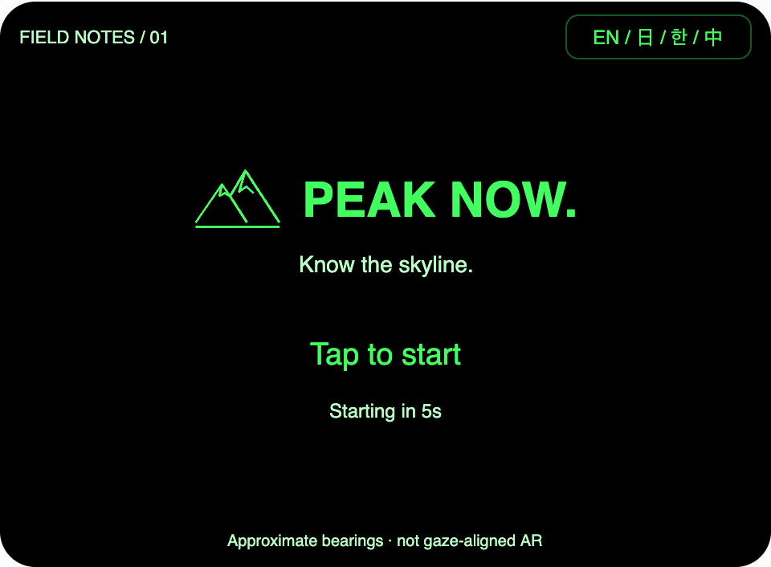
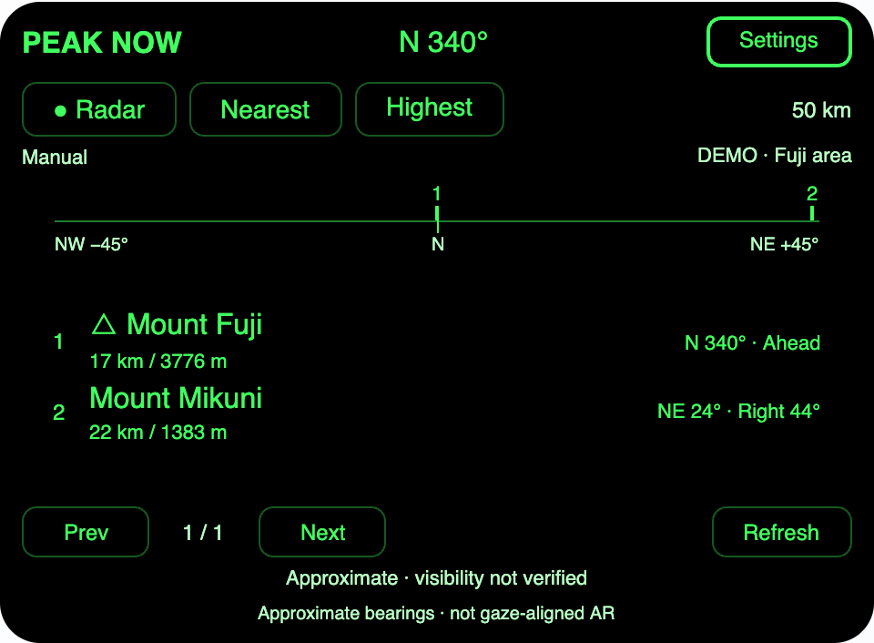

# Peak Now

**What is that mountain?** Nearby summit names, approximate bearings, straight-line
distances and elevations on Rokid Glasses. Built for **AIUI 0.17.0**.

English first · 日本語 · 한국어 · 中文



The original green mountain mark and wordmark follow the sparse composition of
the requested Paddle cover. Tap to start, or wait **five active seconds**.
Opening Language or leaving the Page pauses the countdown.

## Views and data

- **Radar**: three peaks within ±45° of the selected heading. Numbered ticks match
  the rows below; they form a direction diagram, not a scene overlay.
- **Nearest**: every peak in range, sorted by straight-line distance.
- **Highest**: every peak in range, sorted by summit elevation; unknown heights go last.
- Tap a summit for details. Prev / Next show the remaining results.
- Radius: 10, 25, 50 or 100 km. Height filter: all, ≥500, ≥1000 or ≥2000 m.
- Named OpenStreetMap peaks and volcanoes come from two public Overpass endpoints.
  All available language tags are retained so language changes work offline.
- Up to three downloaded areas are stored locally, with a 20% coverage margin.
  Cached data stays usable offline. Data older than 30 days and partial results are
  labeled. Refresh is explicit and limited to one attempt per 30 seconds.



**Direction is approximate.** Auto mode prefers a host-exposed compass, then GPS
course while moving; manual mode fixes a bearing until you change it. The compass
adapter uses the official Accelerometer / Magnetometer sample. Its physical origin
and availability depend on the companion host and need verification on the target
phone and glasses. Magnetic north may differ from true north. GPS course requires
speed ≥1.2 m/s and reported accuracy ≤50 m; it is movement direction, not gaze.
Expired readings become unknown, and Radar shows the Nearest list until a heading
is available. Manual adjustment uses ±15° and Set north; the agent can also open an
exact numeric heading.

This is **not gaze-aligned AR** and does not verify line of sight or identify a mountain
from camera imagery. Summit elevation is OSM data, not your altitude. Distances are
not trail lengths. Mountain names fall back to local names when translations are absent.

## Import into AIUI Studio

```text
Repository: https://github.com/BreezeLife/AIUI-PeakNow
Ref: main (or v1.0.0-preview.1 for the packaged build)
AIUI project directory: /
Runtime: AIUI 0.17.0
Entry: pages/index/index
Preferred surface: _blank
Additional layout: _current (interaction depends on host)
```

Download the [AIX preview build](https://github.com/BreezeLife/AIUI-PeakNow/releases/tag/v1.0.0-preview.1).
The repository root is the complete Studio import project; the AIX is an additional
deliverable. Studio cloud synchronization and device installation use the platform's
import/upload flow.

## Location and controls

The Page requests `GEOLOCATION` after the cover. If location is unavailable, choose
Settings → Location to retry GPS, enter decimal coordinates, or explicitly select
**Try Fuji demo**. The demo uses a small illustrative fixture and is always labeled;
it is never substituted for a failed real lookup or saved as a downloaded area.

| Input | Behavior |
| --- | --- |
| Tap | Activate the visible control or open peak details |
| ArrowUp / ArrowDown | Move visible selection through controls |
| Enter | Activate the selected control |
| Backspace | Return from details/settings; preserve host exit at the root |

Physical key delivery is host-dependent. Buttons provide a fallback. No head
gesture, camera, voice-recognition or background-worker dependency is introduced.

Optional agent launch data:

```json
{ "latitude": 35.22, "longitude": 138.79, "heading": 340, "locale": "en" }
```

Coordinates and heading are explicitly manual when supplied. Language and settings
persist locally. Coordinates and downloaded data are sent only to the Overpass
service used for the lookup. There are no accounts, analytics or API keys.

## Develop

Node 20+; runtime source has no npm dependencies.

```sh
npm ci
npm test
npm run preview
npm run pack
```

`preview` packages first, previews the actual AIX, pins the browser SDK to 0.17.0,
and serves only the preview at localhost:8776. `pack` probes published AIX CLI 0.8.2,
uses `--engine 0.17.0`, verifies its listing and writes to
`~/.codex/outputs/AIUI-PeakNow/peaknow.aix`. Set `PEAKNOW_OUTPUT` for another external
output directory or `AIX_BIN` for an installed CLI.

Run the requested skill audit with:

```sh
SKILL_ROOT=/path/to/rokid-aiui-agent-skill/skills/rokid-aiui-agent npm run audit
```

The two complete, source-bound matrices are in
[AIUI-AUDIT.md](.aiui-evidence/AIUI-AUDIT.md). An audit exit of 2 means a valid blocked
audit. Executed local checks are documented in [VALIDATION.md](docs/VALIDATION.md);
authenticated Studio/device captures and the skill's external authority attestations
remain outstanding. This release is a preview build for import and device testing.

## References

- Workflow: [BreezeLife/rokid-aiui-agent-skill](https://github.com/BreezeLife/rokid-aiui-agent-skill).
- Product inspiration: [kissyjpf/evenhub-peak-radar](https://github.com/kissyjpf/evenhub-peak-radar).
- Cover composition: [Paddle splash](https://raw.githubusercontent.com/nickustinov/paddle-even-g2/main/screenshot-splash.png).
- Data: © [OpenStreetMap contributors](https://www.openstreetmap.org/copyright), ODbL.

Independent Rokid implementation; no Even SDK or upstream application source is
bundled. See [SOURCES.md](docs/SOURCES.md) for pinned API references.
